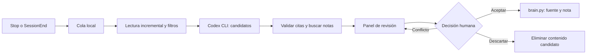

# Arquitectura y decisiones

La implementación mantiene una bóveda central de Markdown separada de los repositorios de cada proyecto. La memoria persiste en los archivos; Codex selecciona qué consultar o incorporar mediante una skill personal.

| Componente | Responsabilidad |
| --- | --- |
| `second-brain` | Notas, originales, índice, registro y revisiones locales |
| `brain.py` | Operaciones de archivos, búsqueda textual, integridad estructural y copias |
| Skill personal | Selección de conocimiento, procedencia, consulta y mantenimiento |
| `install_global.py` | Generar rutas del checkout, preservar configuración y conectar el perfil de Codex |
| Obsidian | Interfaz opcional sobre los mismos archivos |
| `capture.py` | Cola SQLite, adaptador incremental, extracción con modelo, validación y revisión |
| `capture-policy.md` | Criterios explícitos de utilidad, novedad, respaldo y contexto |
| `install_capture.py` | Hooks personales, respaldo y tarea horaria opcional en Windows |

Las fuentes incorporadas se identifican por SHA-256 y se conservan como originales. Las notas derivadas pueden evolucionar con versiones previas, fecha, estado y procedencia. La búsqueda tolera diferencias de acentos; no es semántica.

Las escrituras del helper se serializan con un bloqueo exclusivo. Los reemplazos de notas utilizan archivos temporales y `os.replace`; esto evita exponer un archivo parcialmente escrito, pero no equivale a una transacción de base de datos para todos los archivos de una operación. Un fallo requiere revisar el registro y el índice.

La versión inicial utiliza la biblioteca estándar de Python para sus operaciones. La configuración global se edita con `tomlkit` para conservar los otros ajustes. La instalación pública genera los valores de las rutas en lugar de distribuir una ruta personal fija.

La estructura se inspira en PARA/CODE y en las operaciones de LLM Wiki de Karpathy. Los procedimientos de Matt son referencias y herramientas complementarias; no se distribuye su repositorio como parte de este código. La selección por eventos se implementó como piloto con revisión previa a publicar.

## Recorrido de captura

El hook hace una operación corta; no ejecuta el modelo durante el cierre. La tarea posterior examina un bloque por vez. Las transacciones de la cola y el bloqueo del procesador evitan carreras; el publicador conserva sus propias versiones e índice. Un fallo deja el cursor pendiente y reintenta con espera creciente.

El extractor usa un proceso efímero de Codex con sandbox de lectura y shell, hooks, plugins, apps y memoria nativa desactivados. Recibe texto visible seleccionado y un catálogo acotado. El programa valida la procedencia literal de las citas; la revisión humana evalúa si la conclusión está bien respaldada.

Los detalles de límites, privacidad y recuperación están en [la guía del piloto](AUTOMATIZACION.md). La instalación pública es portable y optativa; no incluye la configuración ni la confianza observadas en el equipo de desarrollo.
