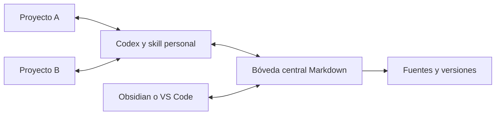

# Instructivo del Second Brain

## Instalación y ubicación

Sigue los comandos del [README](../README.md). La bóveda está en la carpeta `second-brain` de este repositorio; conserva una ubicación estable. El instalador genera la skill con esa ruta y añade la referencia a las instrucciones globales de tu perfil de Codex.

Obsidian es opcional. Para usarlo, instala la aplicación y abre esta carpeta como bóveda existente. Codex y Obsidian trabajan con los mismos Markdown.

## Conexiones y alcance



La skill personal puede utilizar la misma bóveda desde distintas carpetas cuando la sesión tenga acceso a ella. Las instrucciones globales orientan al asistente para consultar conocimiento pertinente y registrar hallazgos duraderos en hitos del trabajo. Las reglas del entorno o del proyecto pueden limitar ese acceso.

Una conversación nueva recupera las notas necesarias; no recibe por esta instalación todas las conversaciones anteriores. La cuenta de ChatGPT y la carpeta local no se sincronizan mediante este instalador. Las skills originales de Matt son una instalación separada y conservan su propio alcance.

## Uso en el chat

| Momento | Mensaje posible |
| --- | --- |
| Aparece una idea | «Guarda esta idea como propuesta en second-brain: ...» |
| Empieza un proyecto | «Consulta second-brain y ayúdame a definir el objetivo y la primera entrega de este proyecto» |
| Hay un aprendizaje comprobado | «Guarda el resultado, su evidencia y sus límites; busca antes si ya existe una nota relacionada» |
| Se retoma trabajo | «Recupera dónde quedamos y contrástalo con los archivos actuales del proyecto» |
| Hace falta mantenimiento | «Revisa enlaces, fuentes, vigencia y posibles contradicciones» |

El asistente debe indicar los archivos consultados o guardados. Conserva el código y las tareas detalladas en su proyecto; publica en la memoria las conclusiones reutilizables y referencias a su origen.

## Carpetas y estados

`00-entrada` conserva ideas; `10-proyectos`, fichas y referencias; `20-areas`, responsabilidades continuas; `30-conocimiento`, aprendizajes reutilizables; `40-archivo`, material inactivo; `80-fuentes`, originales con procedencia; y `90-plantillas`, los formatos iniciales.

Los estados de conocimiento son confirmado, propuesto, hipótesis y obsoleto. Una hipótesis importante sigue siendo una hipótesis. El estado confirmado debe quedar limitado a la evidencia y el contexto declarados.

## Mantenimiento técnico

Desde la raíz del repositorio:

```powershell
python second-brain-tools/brain.py status
python second-brain-tools/brain.py search "mi tema"
python second-brain-tools/brain.py reindex
python second-brain-tools/brain.py lint
python second-brain-tools/brain.py backup
```

Desde otra carpeta, utiliza la ruta absoluta de `brain.py`; el helper resuelve la bóveda por su propia ubicación. `--vault` selecciona una copia aislada cuya carpeta debe existir.

Para conservar una fuente y publicar conocimiento:

```powershell
python second-brain-tools/brain.py capture-source --input documento.md --title "Fuente" --origin "Procedencia y fecha"
python second-brain-tools/brain.py publish --path "30-conocimiento/mi-nota.md" --title "Mi nota" --body cuerpo.md --source "Procedencia" --state propuesto
```

El cuerpo va sin frontmatter ni título H1. El helper agrega metadatos, título y fuentes. `--source` admite varias apariciones. Para enlazar una fuente interna utiliza su ruta relativa a la bóveda, como la devuelta por `capture-source`. En la terminal, el estado de hipótesis se escribe `hipotesis`.

`publish` conserva la versión previa y actualiza índice y registro. Una publicación idéntica no crea otra revisión. Las ediciones directas desde Obsidian o un editor requieren regenerar el índice y no producen automáticamente el historial del helper.

## Comprobaciones y recuperación

`lint` comprueba enlaces locales, vigencia del índice y hashes de fuentes registradas. La exactitud factual y las contradicciones requieren leer y razonar sobre las fuentes.

`backup` crea una copia ZIP fuera de la bóveda, en `second-brain-backups`. Para recuperar una nota, extrae primero la copia en otra carpeta y compara lo que necesitas. El instalador también conserva los archivos globales previos; su manifiesto local indica la ubicación.

Si la skill no aparece, abre una sesión nueva de Codex. Si falta acceso a la bóveda desde otro proyecto, revisa los permisos efectivos de ese entorno. Si mueves el repositorio, revisa y vuelve a aplicar su instalación para actualizar las rutas; no cambies fuentes con hash para ocultar una alteración.

## Mejoras futuras

Modifica el protocolo de la bóveda para cambiar su procedimiento y la skill fuente para cambiar sus puntos de entrada. Ejecuta las pruebas del código, previsualiza la instalación, aplícala y comprueba `--check`. Las rutas de la skill pública se completan durante esa instalación.

La [captura automática](../docs/AUTOMATIZACION.md), la búsqueda semántica, un conector MCP y las incorporaciones desde otras aplicaciones son ampliaciones. Esta versión no instala esos servicios ni programa tareas de fondo.
